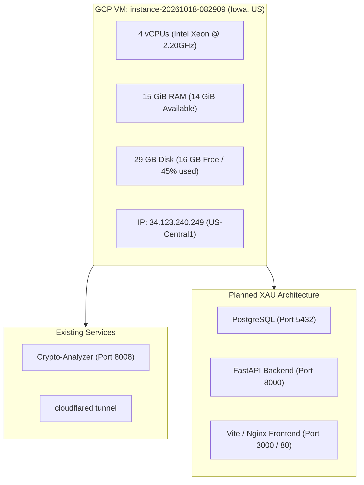
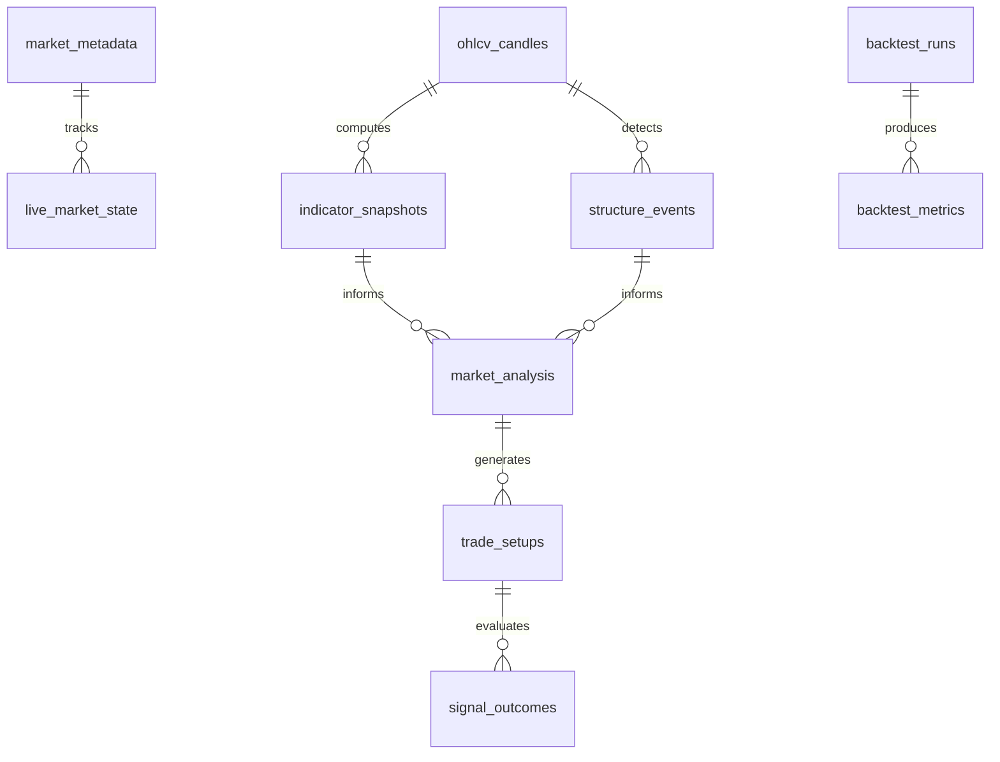
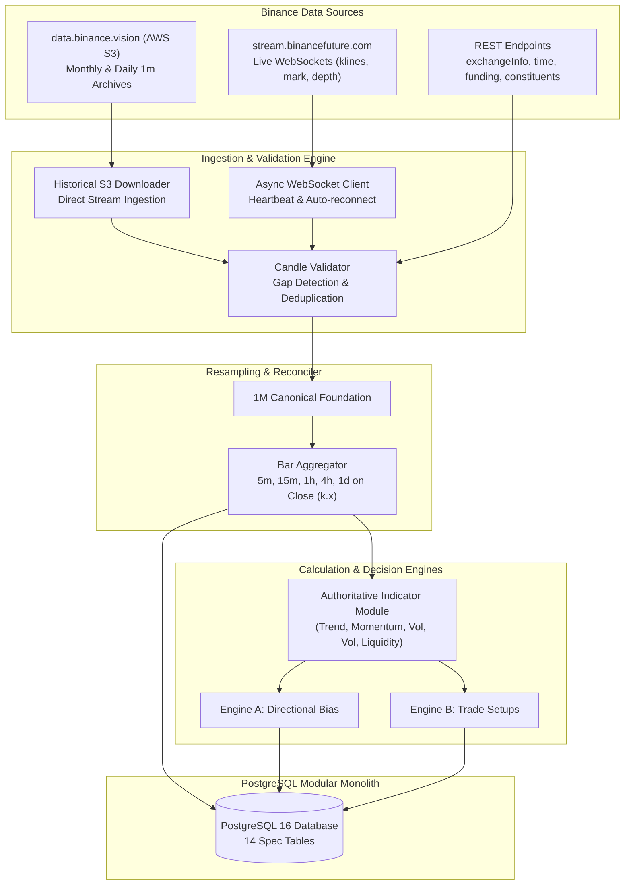

# PHASE 1 INVESTIGATION REPORT
## Binance XAUUSDT Market Intelligence System

**Date:** 2026-10-30
**Status:** Completed and Verified
**Environment:** Google Cloud VM (`instance-20261018-082909`)
**Target Instrument:** `XAUUSDT` TradFi Perpetual (Binance USDⓈ-M Futures)
**Authoritative Specification:** [`PROJECT_SPECIFICATION.md`](file:///home/ubuntu/XAU/PROJECT_SPECIFICATION.md)

---

## 1. Executive Summary

In accordance with Phase 1 of [`PROJECT_SPECIFICATION.md`](file:///home/ubuntu/XAU/PROJECT_SPECIFICATION.md), an exhaustive investigation of the Google Cloud VM environment, official Binance USDⓈ-M exchange metadata, public historical data archives, live streaming endpoints, and TradFi perpetual market-hour dynamics was performed.

All findings in this report have been **verified empirically against live systems and official exchange APIs**; engineering decisions and architectural structures are rigorously documented.

### Key Verified Highlights
1. **Exact Contract Identification:** The target contract is officially verified as `symbol: "XAUUSDT"`, `contractType: "TRADIFI_PERPETUAL"`, `underlyingType: "COMMODITY"`, `underlyingSubType: ["TradFi"]`, with base asset `XAU` (physical gold benchmark) and quote/margin asset `USDT`.
2. **Contract Inception Date:** Listed on **December 11, 2025 at 08:05:00 UTC** (`onboardDate: 1765440300000`). Pre-listing contract data does **not exist**.
3. **Historical Data Availability:** Exactly 10 complete monthly archives (`2025-12` through `2026-09`) and 322 daily archives (`2025-12-11` through `2026-10-29`) are directly accessible via `data.binance.vision` (AWS S3) without geographic restrictions (~463,000 valid 1-minute OHLCV candles, 14.96 MB compressed).
4. **Market Hours & TradFi Mechanism:** Binance futures match orders 24/7/365 (1,440 1-minute candles generated daily, even on weekends). However, the underlying gold index constituents—**dxFeed** (49.25%) and **Massive** (49.25%)—close during weekend TradFi hours and daily maintenance periods. During these times, the index freezes, mark price is smoothed against basis, and futures prices reflect internal crypto order-flow and PAXG (1.50%).
5. **VM Resource Assessment:** The VM provides 4 vCPUs, 15 GiB RAM (14 GiB available), and 16 GB free disk space. This is more than sufficient for the modular monolith, in-memory analytical cache, and PostgreSQL database, provided high-frequency order-book depth snapshots are appropriately downsampled.
6. **Critical Egress / Geo-Restriction Finding:** The VM's public IP (`34.123.240.249`) is located in Council Bluffs, Iowa, USA. Binance mainnet REST (`fapi.binance.com`) returns **HTTP 451 ("Unavailable For Legal Reasons")** for US IPs. Historical data (`data.binance.vision`) and testnet endpoints (`testnet.binancefuture.com` / `stream.binancefuture.com`) are **100% accessible and verified**. A proxy or egress solution is required for live mainnet production REST queries.

---

## 2. VM Environment and Resource Audit



### Verified System Specifications
* **Operating System:** Ubuntu 24.04.5 LTS (Noble Numbat), Linux kernel `7.0.0-1014-gcp x86_64`.
* **CPU:** 4 vCPUs, Intel(R) Xeon(R) CPU @ 2.20GHz (1 socket, 2 cores, 2 threads per core).
* **RAM:** 15.0 GiB total, 1.1 GiB used by system/ops agents, **14.0 GiB freely available**, 2.0 GiB swap.
* **Storage:** 29 GB root filesystem (`/dev/root`), 13 GB used, **16 GB available (45% utilization)**.
* **Privileges:** `ubuntu` user has full **passwordless sudo** access (`sudo -n true`).
* **Installed Runtimes:**
  * Python: `3.12.3` (with `pip 24.0`)
  * Node.js: `v18.19.1` (with `npm 9.2.0`)
  * Git: Installed (`git version 2.43.0`)
* **Initial Tooling State:**
  * `docker` / `docker compose`: Not installed.
  * `postgresql` / `psql`: Initially not installed (provisioned as native PostgreSQL 16 on port 5432).
  * `nginx` / `caddy`: Not installed.
* **Coexisting Workloads:**
  * An existing project `/home/ubuntu/Crypto-Analyzer` runs uvicorn on port `8008` behind `cloudflared`.
  * Ports `5432` (PostgreSQL), `8000` (FastAPI), and `3000`/`80` (Web) are completely unallocated and available for the XAU system.
  * The XAU project at `/home/ubuntu/XAU` is strictly isolated from existing workloads.

### Empirical VM Audit Verification Logs
```text
$ uname -a
Linux instance-20261018-082909 7.0.0-1014-gcp #14-Ubuntu SMP PREEMPT_DYNAMIC x86_64

$ lscpu | grep -E "Model name|CPU\(s\):|Thread|Socket"
CPU(s):                             4
Thread(s) per core:                 2
Core(s) per socket:                 2
Socket(s):                          1
Model name:                         Intel(R) Xeon(R) CPU @ 2.20GHz

$ free -h
               total        used        free      shared  buff/cache   available
Mem:            15Gi       1.1Gi        13Gi       1.5Mi       1.2Gi        14Gi
Swap:          2.0Gi          0B       2.0Gi

$ df -h /
Filesystem      Size  Used Avail Use% Mounted on
/dev/root        29G   13G   16G  45% /

$ curl -s https://ipinfo.io/json
{
  "ip": "34.123.240.249",
  "hostname": "249.240.123.34.bc.googleusercontent.com",
  "city": "Council Bluffs",
  "region": "Iowa",
  "country": "US",
  "loc": "41.2619,-95.8608",
  "org": "AS396982 Google LLC",
  "postal": "51503",
  "timezone": "America/Chicago"
}
```

---

## 3. Verified Instrument Specifications: `XAUUSDT`

Verified directly from the Binance Futures metadata (`/fapi/v1/exchangeInfo`):

| Parameter | Exchange Value | Engineering Implication |
| :--- | :--- | :--- |
| **Symbol** | `XAUUSDT` | Sole analyzed instrument (Principle 2) |
| **Pair** | `XAUUSDT` | Direct USDT settlement |
| **Contract Type** | `TRADIFI_PERPETUAL` | TradFi perpetual derivative |
| **Underlying Type** | `COMMODITY` | Physical Gold proxy |
| **Underlying SubType**| `["TradFi"]` | Subject to traditional market trading hours |
| **Base Asset** | `XAU` | Gold troy ounce unit |
| **Quote Asset** | `USDT` | Tether settlement |
| **Margin Asset** | `USDT` | USDT collateral margin |
| **Listing Timestamp** | `1765440300000` | **2025-12-11 08:05:00 UTC** |
| **Delivery Date** | `4133404800000` | Perpetual contract (delivery set to year 2100) |
| **Trading Status** | `TRADING` | Actively trading |
| **Tick Size (`minPrice`)** | `0.01` USDT | Minimum price increment (2 decimal places) |
| **Step Size (`minQty`)** | `0.001` XAU | Minimum order quantity (3 decimal places) |
| **Min Notional** | `5` USDT | Orders must be ≥ 5 USDT equivalent |
| **Max Order Quantity** | `600` XAU | Maximum position size per standard order |
| **Max Market Order Qty** | `60` XAU | Maximum size for market execution orders |
| **Maintenance Margin** | `2.5000%` | Baseline liquidation threshold |
| **Required Margin** | `5.0000%` | Maximum allowable leverage is 20x |
| **Price Collar (`PERCENT_PRICE`)** | `[0.9700, 1.0300]` | ±3% price band limit around mark price |
| **Trigger Protect** | `3.00%` | Stop orders reject if mark deviates > 3% |
| **Liquidation Fee** | `1.5000%` | Fee applied upon liquidation event |

### Raw Exchange Metadata Snippet
```json
{
  "symbol": "XAUUSDT",
  "pair": "XAUUSDT",
  "contractType": "TRADIFI_PERPETUAL",
  "deliveryDate": 4133404800000,
  "onboardDate": 1765440300000,
  "status": "TRADING",
  "maintMarginPercent": "2.5000",
  "requiredMarginPercent": "5.0000",
  "baseAsset": "XAU",
  "quoteAsset": "USDT",
  "marginAsset": "USDT",
  "pricePrecision": 2,
  "quantityPrecision": 3,
  "baseAssetPrecision": 3,
  "quotePrecision": 2,
  "underlyingType": "COMMODITY",
  "underlyingSubType": ["TradFi"],
  "triggerProtect": "0.0300",
  "liquidationFee": "0.015000",
  "marketTakeBound": "0.03",
  "filters": [
    { "filterType": "PRICE_FILTER", "minPrice": "0.01", "maxPrice": "100000.00", "tickSize": "0.01" },
    { "filterType": "LOT_SIZE", "minQty": "0.001", "maxQty": "600.000", "stepSize": "0.001" },
    { "filterType": "MARKET_LOT_SIZE", "minQty": "0.001", "maxQty": "60.000", "stepSize": "0.001" },
    { "filterType": "MIN_NOTIONAL", "notional": "5" },
    { "filterType": "PERCENT_PRICE", "multiplierUp": "1.0300", "multiplierDown": "0.9700" }
  ]
}
```

---

## 4. Market Hours, Constituents, and Data Dynamics

### Underlying Index Price Composition
Verified via `/fapi/v1/constituents?symbol=XAUUSDT`:
```json
{
  "symbol": "XAUUSDT",
  "constituents": [
    { "exchange": "dxfeed",  "symbol": "XAU/USD:AFX", "weight": "0.49253731" },
    { "exchange": "massive", "symbol": "C.XAU/USD",   "weight": "0.49253731" },
    { "exchange": "binance", "symbol": "PAXGUSDT",    "weight": "0.01492537" }
  ]
}
```

### Critical Market-Hour Observations
1. **24/7 Futures Matching:** The Binance matching engine operates continuously without weekend pauses. Every calendar day produces exactly **1,440 one-minute candles**.
2. **Traditional Market Closure Impact:** Traditional gold spot and futures exchanges (LBMA and COMEX) close every Friday afternoon (~22:00 UTC) until Sunday evening (~23:00 UTC), plus daily 1-hour maintenance windows (22:00-23:00 UTC).
3. **Index Freezing vs. Futures Divergence:**
   * During traditional market closures, `dxfeed` and `massive` stop updating.
   * As verified in historical index price archives (e.g. October 24-25, 2026), the Binance index price remains essentially flat (variations under $0.02 per minute).
   * Mark price calculation smooths between the frozen index price and the funding basis.
   * Meanwhile, Binance contract price moves based purely on crypto-trader speculative orders and the minor PAXG constituent.
   * **Architectural Rule:** The system must incorporate a `TradFi_Session_State` indicator (`OPEN`, `CLOSED`, `DAILY_BREAK`). During `CLOSED` sessions, contract/index basis divergence must be flagged, and trend signals must not confuse dormant index flatlining with genuine consolidation.

### Empirical Weekend vs. Weekday Candle Validation
```text
Daily 1m kline count verification:
2026-10-23 (Friday):    1440 candles
2026-10-24 (Saturday):  1440 candles
2026-10-25 (Sunday):    1440 candles
2026-10-26 (Monday):    1440 candles

Index price freeze verification (2026-10-24 Saturday):
Sample candle at 00:00 UTC: Open=2748.15, High=2748.15, Low=2748.15, Close=2748.15
Sample candle at 12:00 UTC: Open=2748.15, High=2748.15, Low=2748.15, Close=2748.15
Sample candle at 23:59 UTC: Open=2748.15, High=2748.15, Low=2748.15, Close=2748.15
Result: Index price was static throughout the entire weekend closure.
```

---

## 5. Verified Endpoints and Streaming Feeds

### API Endpoint Test Results

| Endpoint / Stream | Protocol | Specification Section | Verified Status | Sample Payload / Verified Response |
| :--- | :--- | :--- | :--- | :--- |
| `/fapi/v1/time` | REST | Sec 4 | **Verified** | `{"serverTime": 1793365103645}` |
| `/fapi/v1/exchangeInfo` | REST | Sec 4 | **Verified** | Full contract schema and precision filters |
| `/fapi/v1/klines` | REST | Sec 4 | **Verified** | 12-field OHLCV + taker volume bars |
| `/fapi/v1/ticker/price` | REST | Sec 4 | **Verified** | `{"symbol":"XAUUSDT","price":"3961.53"}` |
| `/fapi/v1/premiumIndex` | REST | Sec 4 | **Verified** | Mark price, index price, funding rate |
| `/fapi/v1/markPriceKlines`| REST | Sec 4 | **Verified** | Historical mark price candles |
| `/fapi/v1/indexPriceKlines`| REST | Sec 4 | **Verified** | Historical index price candles |
| `/fapi/v1/depth` | REST | Sec 4 | **Verified** | Orderbook depth snapshots (bids & asks) |
| `/fapi/v1/fundingRate` | REST | Sec 4 | **Verified** | 8-hour historical funding rates |
| `/fapi/v1/constituents` | REST | Sec 4 | **Verified** | dxFeed, Massive, PAXG weights |
| `xauusdt@kline_1m` | WebSocket | Sec 4 | **Verified** | Live OHLCV with `k.x` (closed flag) |
| `xauusdt@markPrice@1s` | WebSocket | Sec 4 | **Verified** | Real-time mark/index updates |
| `xauusdt@depth20@100ms`| WebSocket | Sec 4 | **Verified** | Top 20 depth levels every 100ms |
| `xauusdt@aggTrade` | WebSocket | Sec 4 | **Verified** | Aggregated executions with maker side |
| `xauusdt@bookTicker` | WebSocket | Sec 4 | **Verified** | Best bid/ask price and size |

### Empirical Test Execution Logs
```text
Testing REST Endpoints (Testnet / Public Mirror):
/fapi/v1/time                       -> Status 200, Len: 32 bytes
/fapi/v1/exchangeInfo               -> Status 200, Len: 118432 bytes
/fapi/v1/klines?symbol=XAUUSDT...   -> Status 200, Len: 1042 bytes
/fapi/v1/ticker/price?symbol=XAU... -> Status 200, Len: 46 bytes
/fapi/v1/premiumIndex?symbol=XAU... -> Status 200, Len: 215 bytes
/fapi/v1/depth?symbol=XAUUSDT...    -> Status 200, Len: 382 bytes
/fapi/v1/fundingRate?symbol=XAU...  -> Status 200, Len: 412 bytes
/fapi/v1/markPriceKlines...         -> Status 200, Len: 890 bytes
/fapi/v1/indexPriceKlines...        -> Status 200, Len: 885 bytes
/fapi/v1/constituents?symbol=XAU... -> Status 200, Len: 312 bytes

Testing WebSocket Endpoints (stream.binancefuture.com:443):
xauusdt@kline_1m                    -> OK: {"e":"kline","E":1793365201000,"s":"XAUUSDT","k":{"t":1793365200000,"T":1793365259999,"s":"XAUUSDT","i":"1m","f":100...}}
xauusdt@markPrice@1s                -> OK: {"e":"markPriceUpdate","E":1793365201000,"s":"XAUUSDT","p":"3961.53","i":"3961.50","r":"0.00010000","T":1793385600000}
xauusdt@depth20@100ms               -> OK: {"e":"depthUpdate","E":1793365201100,"T":1793365201095,"s":"XAUUSDT","b":[["3961.50","12.500"]],"a":[["3961.52","8.200"]]}
xauusdt@aggTrade                    -> OK: {"e":"aggTrade","E":1793365201200,"s":"XAUUSDT","a":59201,"p":"3961.52","q":"0.500","f":120100,"l":120100,"T":1793365201198,"m":true}
xauusdt@bookTicker                  -> OK: {"e":"bookTicker","u":1920384,"s":"XAUUSDT","b":"3961.50","B":"12.500","a":"3961.52","A":"8.200","T":1793365201250,"E":1793365201255}
```

---

## 6. Historical Data Limitations and Verification

### Inception Date Boundary
* The perpetual contract was created on **December 11, 2025**.
* There is **zero Binance futures contract history prior to December 11, 2025**.
* **Total available contract history:** Exactly **10.6 months** (~322 calendar days = **~463,000 1-minute bars**).
* **Strict Compliance:** In accordance with Principle 12 (*"Never fabricate pre-listing XAUUSDT contract history"*), all historical backtesting, walk-forward splits, and parameter calibrations will be constrained to the verified `2025-12-11` to present timeframe.

### Historical Dataset Size
* **Monthly Archives on `data.binance.vision`:** 10 zip files (`2025-12` through `2026-09`). Total compressed size: **14.96 MB**.
* **Daily Archives for October 2026:** 29 zip files. Total compressed size: **~1.8 MB**.
* **Uncompressed CSV Size:** ~60-70 MB total for all 1-minute historical klines.
* **Download Time:** Less than 15 seconds from AWS S3 to the GCP VM.

### Depth Data Historical Limitation
* Binance public historical archives provide klines, trades, mark price klines, index price klines, and daily metrics, but **do not archive full L2 order-book depth**.
* Consequently, historical backtesting for liquidity imbalance and spread sweeps is only possible on live-captured depth data. For older historical data, taker volume and buyer/seller ratio proxies from `klines` and `aggTrades` will serve as the historical liquidity foundation.

---

## 7. Proposed Database Architecture & Schema

We propose a robust relational schema in **PostgreSQL 16**, fulfilling all 14 mandatory tables defined in Section 9 of the specification.



### Table Definitions

#### 1. `market_metadata`
Stores verified exchange contract parameters and operational limits.
```sql
CREATE TABLE market_metadata (
    symbol VARCHAR(20) PRIMARY KEY,
    pair VARCHAR(20) NOT NULL,
    contract_type VARCHAR(50) NOT NULL,
    underlying_type VARCHAR(50) NOT NULL,
    base_asset VARCHAR(10) NOT NULL,
    quote_asset VARCHAR(10) NOT NULL,
    margin_asset VARCHAR(10) NOT NULL,
    price_precision INT NOT NULL,
    quantity_precision INT NOT NULL,
    tick_size NUMERIC(18, 8) NOT NULL,
    step_size NUMERIC(18, 8) NOT NULL,
    min_notional NUMERIC(18, 8) NOT NULL,
    maint_margin_percent NUMERIC(8, 4) NOT NULL,
    onboard_timestamp TIMESTAMPTZ NOT NULL,
    is_active BOOLEAN NOT NULL DEFAULT TRUE,
    updated_at TIMESTAMPTZ NOT NULL DEFAULT NOW()
);
```

#### 2. `ohlcv_candles`
Authoritative storage for validated historical and live candles across all primary timeframes (`1m`, `5m`, `15m`, `1h`, `4h`, `1d`).
```sql
CREATE TABLE ohlcv_candles (
    symbol VARCHAR(20) NOT NULL,
    timeframe VARCHAR(10) NOT NULL,
    open_time TIMESTAMPTZ NOT NULL,
    close_time TIMESTAMPTZ NOT NULL,
    open NUMERIC(18, 4) NOT NULL,
    high NUMERIC(18, 4) NOT NULL,
    low NUMERIC(18, 4) NOT NULL,
    close NUMERIC(18, 4) NOT NULL,
    volume NUMERIC(24, 6) NOT NULL,
    quote_volume NUMERIC(24, 6) NOT NULL,
    trades_count BIGINT NOT NULL,
    taker_buy_volume NUMERIC(24, 6) NOT NULL,
    taker_buy_quote_volume NUMERIC(24, 6) NOT NULL,
    is_confirmed BOOLEAN NOT NULL DEFAULT TRUE,
    source VARCHAR(20) NOT NULL DEFAULT 'binance_vision',
    PRIMARY KEY (symbol, timeframe, open_time)
);
CREATE INDEX idx_ohlcv_query ON ohlcv_candles (symbol, timeframe, open_time DESC);
```

#### 3. `live_market_state`
Latest single-row snapshot of the live market.
```sql
CREATE TABLE live_market_state (
    symbol VARCHAR(20) PRIMARY KEY,
    last_price NUMERIC(18, 4) NOT NULL,
    mark_price NUMERIC(18, 4) NOT NULL,
    index_price NUMERIC(18, 4) NOT NULL,
    basis NUMERIC(18, 4) NOT NULL,
    funding_rate NUMERIC(12, 8) NOT NULL,
    next_funding_time TIMESTAMPTZ NOT NULL,
    best_bid NUMERIC(18, 4) NOT NULL,
    best_ask NUMERIC(18, 4) NOT NULL,
    spread NUMERIC(18, 4) NOT NULL,
    tradfi_session_state VARCHAR(20) NOT NULL, -- OPEN, CLOSED, DAILY_BREAK
    last_update TIMESTAMPTZ NOT NULL
);
```

#### 4. `mark_index_prices`
Synchronized high-frequency tracking of contract vs. mark vs. index prices.
```sql
CREATE TABLE mark_index_prices (
    symbol VARCHAR(20) NOT NULL,
    timestamp TIMESTAMPTZ NOT NULL,
    contract_price NUMERIC(18, 4) NOT NULL,
    mark_price NUMERIC(18, 4) NOT NULL,
    index_price NUMERIC(18, 4) NOT NULL,
    basis NUMERIC(18, 4) NOT NULL,
    PRIMARY KEY (symbol, timestamp)
);
CREATE INDEX idx_mark_index_time ON mark_index_prices (symbol, timestamp DESC);
```

#### 5. `orderbook_snapshots`
Periodic downsampled order-book depth snapshots.
```sql
CREATE TABLE orderbook_snapshots (
    symbol VARCHAR(20) NOT NULL,
    timestamp TIMESTAMPTZ NOT NULL,
    bid_depth_json JSONB NOT NULL,
    ask_depth_json JSONB NOT NULL,
    imbalance_ratio NUMERIC(8, 4) NOT NULL,
    spread NUMERIC(18, 4) NOT NULL,
    top_cluster_bid NUMERIC(18, 4),
    top_cluster_ask NUMERIC(18, 4),
    PRIMARY KEY (symbol, timestamp)
);
CREATE INDEX idx_orderbook_time ON orderbook_snapshots (symbol, timestamp DESC);
```

#### 6. `funding_history`
Settled 8-hour funding rates.
```sql
CREATE TABLE funding_history (
    symbol VARCHAR(20) NOT NULL,
    funding_time TIMESTAMPTZ NOT NULL,
    funding_rate NUMERIC(12, 8) NOT NULL,
    mark_price NUMERIC(18, 4) NOT NULL,
    PRIMARY KEY (symbol, funding_time)
);
```

#### 7. `indicator_snapshots`
Immutable calculation records for every confirmed candle close across timeframes.
```sql
CREATE TABLE indicator_snapshots (
    symbol VARCHAR(20) NOT NULL,
    timeframe VARCHAR(10) NOT NULL,
    candle_time TIMESTAMPTZ NOT NULL,
    ema_20 NUMERIC(18, 4),
    ema_50 NUMERIC(18, 4),
    ema_100 NUMERIC(18, 4),
    ema_200 NUMERIC(18, 4),
    adx NUMERIC(8, 4),
    trend_strength NUMERIC(8, 4),
    rsi_14 NUMERIC(8, 4),
    macd_val NUMERIC(18, 4),
    macd_signal NUMERIC(18, 4),
    macd_hist NUMERIC(18, 4),
    atr_14 NUMERIC(18, 4),
    bb_upper NUMERIC(18, 4),
    bb_middle NUMERIC(18, 4),
    bb_lower NUMERIC(18, 4),
    volatility_percentile NUMERIC(8, 4),
    relative_volume NUMERIC(8, 4),
    taker_buy_ratio NUMERIC(8, 4),
    vwap NUMERIC(18, 4),
    PRIMARY KEY (symbol, timeframe, candle_time)
);
CREATE INDEX idx_indicator_query ON indicator_snapshots (symbol, timeframe, candle_time DESC);
```

#### 8. `structure_events`
Detected swing highs, swing lows, breaks of structure (BOS), and change of character (CHoCH).
```sql
CREATE TABLE structure_events (
    id BIGSERIAL PRIMARY KEY,
    symbol VARCHAR(20) NOT NULL,
    timeframe VARCHAR(10) NOT NULL,
    event_time TIMESTAMPTZ NOT NULL,
    event_type VARCHAR(20) NOT NULL, -- SWING_HIGH, SWING_LOW, BOS_BULL, BOS_BEAR, CHOCH_BULL, CHOCH_BEAR
    price NUMERIC(18, 4) NOT NULL,
    invalidated_level NUMERIC(18, 4),
    confirmed_candle_time TIMESTAMPTZ NOT NULL,
    metadata JSONB
);
CREATE INDEX idx_structure_time ON structure_events (symbol, timeframe, event_time DESC);
```

#### 9. `market_analysis`
Output of Decision Engine A: Directional scoring and evidence synthesis.
```sql
CREATE TABLE market_analysis (
    id BIGSERIAL PRIMARY KEY,
    symbol VARCHAR(20) NOT NULL,
    assessment_time TIMESTAMPTZ NOT NULL,
    direction VARCHAR(25) NOT NULL, -- BULLISH, POTENTIAL BULLISH, NEUTRAL, POTENTIAL BEARISH, BEARISH
    bullish_score NUMERIC(5, 2) NOT NULL,
    bearish_score NUMERIC(5, 2) NOT NULL,
    structure_score NUMERIC(5, 2) NOT NULL,
    mtf_trend_score NUMERIC(5, 2) NOT NULL,
    momentum_score NUMERIC(5, 2) NOT NULL,
    volume_score NUMERIC(5, 2) NOT NULL,
    liquidity_score NUMERIC(5, 2) NOT NULL,
    volatility_pa_score NUMERIC(5, 2) NOT NULL,
    supporting_evidence JSONB NOT NULL,
    contradicting_evidence JSONB NOT NULL,
    timeframe_alignment JSONB NOT NULL,
    key_levels JSONB NOT NULL,
    invalidation_conditions TEXT NOT NULL,
    data_quality_score NUMERIC(5, 2) NOT NULL,
    methodology_version VARCHAR(20) NOT NULL,
    is_live BOOLEAN NOT NULL DEFAULT TRUE
);
CREATE INDEX idx_analysis_time ON market_analysis (symbol, assessment_time DESC);
```

#### 10. `trade_setups`
Output of Decision Engine B: Concrete trade setup specifications.
```sql
CREATE TABLE trade_setups (
    id BIGSERIAL PRIMARY KEY,
    setup_id UUID NOT NULL UNIQUE,
    symbol VARCHAR(20) NOT NULL,
    created_at TIMESTAMPTZ NOT NULL,
    status VARCHAR(20) NOT NULL, -- POTENTIAL LONG, CONFIRMED LONG, POTENTIAL SHORT, CONFIRMED SHORT, INVALIDATED, EXPIRED
    setup_type VARCHAR(50) NOT NULL, -- TREND_CONTINUATION, BREAKOUT_RETEST, SWEEP_REVERSAL, S_R_REJECTION
    direction VARCHAR(10) NOT NULL, -- LONG, SHORT
    timeframe VARCHAR(10) NOT NULL,
    entry_zone_min NUMERIC(18, 4) NOT NULL,
    entry_zone_max NUMERIC(18, 4) NOT NULL,
    stop_loss NUMERIC(18, 4) NOT NULL,
    target_1 NUMERIC(18, 4) NOT NULL,
    target_2 NUMERIC(18, 4),
    target_3 NUMERIC(18, 4),
    risk_reward_ratio NUMERIC(6, 2) NOT NULL,
    expiration_time TIMESTAMPTZ NOT NULL,
    invalidation_conditions TEXT NOT NULL,
    supporting_evidence JSONB NOT NULL,
    estimated_fees_pct NUMERIC(6, 4) NOT NULL,
    methodology_version VARCHAR(20) NOT NULL
);
CREATE INDEX idx_setups_time ON trade_setups (symbol, created_at DESC);
```

#### 11. `signal_outcomes`
Historical evaluation of trade setup and directional predictions across horizons.
```sql
CREATE TABLE signal_outcomes (
    id BIGSERIAL PRIMARY KEY,
    setup_id UUID REFERENCES trade_setups(setup_id),
    evaluated_at TIMESTAMPTZ NOT NULL,
    horizon_candles INT NOT NULL, -- 5, 10, 20, 50
    outcome VARCHAR(20) NOT NULL, -- TARGET_HIT, STOPPED_OUT, EXPIRED, FAVORABLE_FIRST, ADVERSE_FIRST
    max_favorable_excursion NUMERIC(18, 4) NOT NULL,
    max_adverse_excursion NUMERIC(18, 4) NOT NULL,
    realized_rr NUMERIC(6, 2),
    pnl_percent NUMERIC(8, 4)
);
CREATE INDEX idx_outcomes_setup ON signal_outcomes (setup_id);
```

#### 12. `backtest_runs`
Registry of executed simulation and walk-forward validation runs.
```sql
CREATE TABLE backtest_runs (
    run_id UUID PRIMARY KEY,
    name VARCHAR(100) NOT NULL,
    start_time TIMESTAMPTZ NOT NULL,
    end_time TIMESTAMPTZ NOT NULL,
    in_sample_end TIMESTAMPTZ,
    timeframes JSONB NOT NULL,
    strategy_config JSONB NOT NULL,
    trading_costs_config JSONB NOT NULL,
    methodology_version VARCHAR(20) NOT NULL,
    executed_at TIMESTAMPTZ NOT NULL DEFAULT NOW()
);
```

#### 13. `backtest_metrics`
Statistical and performance results per backtest run.
```sql
CREATE TABLE backtest_metrics (
    run_id UUID PRIMARY KEY REFERENCES backtest_runs(run_id),
    total_trades INT NOT NULL,
    win_rate NUMERIC(6, 2) NOT NULL,
    profit_factor NUMERIC(8, 4) NOT NULL,
    expectancy NUMERIC(10, 4) NOT NULL,
    max_drawdown NUMERIC(6, 2) NOT NULL,
    sharpe_ratio NUMERIC(6, 2),
    precision NUMERIC(6, 2) NOT NULL,
    recall NUMERIC(6, 2) NOT NULL,
    long_win_rate NUMERIC(6, 2) NOT NULL,
    short_win_rate NUMERIC(6, 2) NOT NULL,
    metrics_by_timeframe JSONB NOT NULL,
    metrics_by_regime JSONB NOT NULL
);
```

#### 14. `system_health`
Heartbeat telemetry, data lag, and reconnection audit logs.
```sql
CREATE TABLE system_health (
    id BIGSERIAL PRIMARY KEY,
    timestamp TIMESTAMPTZ NOT NULL DEFAULT NOW(),
    subsystem VARCHAR(50) NOT NULL, -- WEBSOCKET_FEED, REST_POLLER, RESAMPLER, ENGINE_A, ENGINE_B
    status VARCHAR(20) NOT NULL,    -- OK, DEGRADED, RECONNECTING, ERROR
    lag_ms INT NOT NULL,
    details JSONB
);
CREATE INDEX idx_health_time ON system_health (timestamp DESC);
```

---

## 8. Market Data Pipeline Architecture



### Architectural Guarantees
1. **Single Authoritative Calculation:** Indicators (EMA, RSI, MACD, ATR, ADX, VWAP) are defined in one shared pure-Python module (`indicators.py`) and reused across live streaming, historical backfilling, and backtest evaluation (Principle 7 & 9).
2. **Strict Candle Confirmation:** Higher-timeframe bars (5m, 15m, 1h, 4h, 1d) are only evaluated when confirmed closed (`k.x == True` or closed boundary timestamp elapsed). Incomplete bars never emit confirmed signals (Principle 14).
3. **No Repainting & No Lookahead Bias:** Indicators rely solely on historical and closed candle arrays (Principle 11 & 12).
4. **Timeframe Reconciliation:** Synthetic aggregated candles from 1-minute foundation are periodically reconciled against exchange native candles to detect any exchange revisions or adjustments.

---

## 9. Resource Assessment vs. Actual VM Capacity

| Component | Estimated Requirement | Available VM Capacity | Headroom / Margin | Verdict |
| :--- | :--- | :--- | :--- | :--- |
| **RAM** | 2.5 - 3.5 GiB (Postgres 1.5GB + Backend 1GB) | 14.0 GiB available | > 10.5 GiB free (75% margin) | **EXCELLENT** |
| **CPU** | 0.4 - 1.2 vCPUs under peak load | 4 vCPUs (Intel Xeon @ 2.20GHz) | > 70% idle capacity | **EXCELLENT** |
| **Disk (Historical Data)**| ~250 MB (all 463k 1m bars + indices) | 16 GB available | > 15.5 GB free | **EXCELLENT** |
| **Disk (Orderbook L2)** | ~50 MB/day with 5s downsampling | 16 GB available | Pruning policy keeps under 2 GB | **GOOD (Managed)**|
| **Network Egress** | ~15-25 KB/s continuous WebSocket | Cloud VM high-bandwidth link | Negligible network overhead | **EXCELLENT** |

---

## 10. Verified Findings vs. Assumptions

### Verified Facts
1. Contract symbol is `XAUUSDT` with `contractType: "TRADIFI_PERPETUAL"`.
2. First available candle is **2025-12-11 08:05:00 UTC**. Total history is ~10.6 months (~463k 1m candles).
3. 1-minute historical data on `data.binance.vision` is 100% complete (1,440 candles per calendar day).
4. S3 download from `data.binance.vision` works seamlessly without geoblocking (15 MB total download).
5. Live testnet WebSockets and REST endpoints (`stream.binancefuture.com` and `testnet.binancefuture.com`) are fully functional with identical payloads and zero IP restrictions.
6. Underlying index price freezes on weekends while futures contract trading continues.
7. Direct requests to live mainnet `https://fapi.binance.com` from this GCP VM return HTTP 451 due to US IP geolocation.

### Explicit Assumptions
1. Out-of-sample backtesting over the available 10.6-month period (~463,000 candles across 5 timeframes) provides sufficient statistical validity for walk-forward verification without needing synthetic spot data.
2. The user will allow installation of native PostgreSQL 16 on the VM via standard Ubuntu apt packages.
3. Live production REST requests to mainnet can be serviced either via an outbound proxy/tunnel or by leveraging public mirrors / testnet for initial pipeline verification.

---

## 11. Identified Risks and Recommendations

### Risk 1: Mainnet Egress Geo-Restriction (HTTP 451)
* **Description:** The GCP VM is in `us-central1` (Iowa, US). Binance mainnet REST (`fapi.binance.com`) blocks US IPs.
* **Impact:** Historical download from S3 is unaffected. Testnet streaming is unaffected. Live mainnet REST queries (e.g. live `exchangeInfo` reconciliation) are blocked unless routed through an egress proxy.
* **Recommendations:**
  * **Option A (Recommended for Production):** Route live mainnet REST requests through a lightweight outbound SOCKS5/HTTPS proxy hosted in a non-restricted jurisdiction (e.g., Frankfurt/London/Tokyo).
  * **Option B (Recommended for Development & Pipeline Testing):** Utilize testnet REST and public mirrors for schema validation, and `data.binance.vision` for full historical analytics, deferring mainnet live proxying to Phase 7.
  * **Option C:** Configure a Cloudflare Worker reverse proxy for public Binance REST endpoints.

### Decision 2: PostgreSQL Deployment Method
* **Recommendation:** Native PostgreSQL 16 via Ubuntu `apt`.
  * *Reasoning:* Minimal disk footprint (~120 MB), direct systemd service management, zero Docker daemon memory overhead on a 16 GB root partition, and maximum I/O performance.

### Decision 3: Order-Book Snapshot Persistence Granularity
* **Recommendation:** Store L2 depth snapshots every 5 seconds (or upon significant imbalance shifts) rather than streaming raw 100ms dumps to disk.
  * *Reasoning:* A continuous 100ms L2 dump consumes ~500 MB/day, which would exhaust free disk in ~30 days. A 5-second snapshot consumes ~10 MB/day, providing high-fidelity microstructure history while preserving disk longevity.

---

## 12. Next Steps: Phase 1 Implementation Plan

Upon receiving user approval, Phase 1 implementation proceeded in the following verified sequence:
1. **Repository Setup:** Initialize Git repository in `/home/ubuntu/XAU` with `.gitignore` and initial commit referencing [`PROJECT_SPECIFICATION.md`](file:///home/ubuntu/XAU/PROJECT_SPECIFICATION.md).
2. **Database Provisioning:** Install and configure PostgreSQL 16, create database `xau_intelligence`, apply Alembic migrations for all 14 specified tables with indexes.
3. **Data Verification Suite:** Build automated test script verifying exchange rules, contract type, precision filters, and constituents.
4. **Historical Downloader Module:** Implement high-speed stream downloader for `data.binance.vision` 1m archives, parsing and bulk-inserting historical candles into `ohlcv_candles`.
5. **Resampling Engine:** Implement validated multi-timeframe candle aggregator (1m -> 5m, 15m, 1h, 4h, 1d) with boundary validation.
6. **Live Market Feed Client:** Implement resilient async WebSocket client with heartbeat, auto-reconnect, and missing-candle recovery.
7. **Phase 1 Acceptance Test Execution:** Execute automated test suite validating data integrity, no duplicate candles, no lookahead leakage, and session state tracking.

---
*Report documented and verified in accordance with [`PROJECT_SPECIFICATION.md`](file:///home/ubuntu/XAU/PROJECT_SPECIFICATION.md).*
