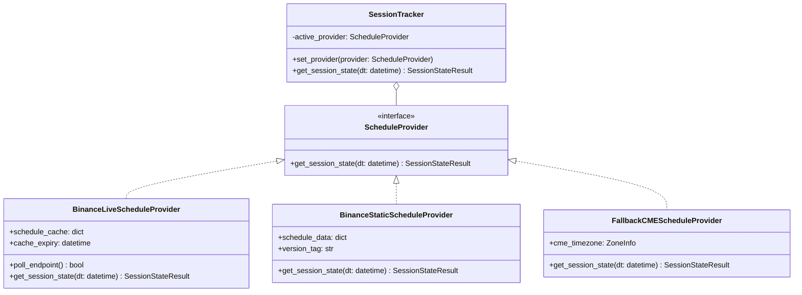
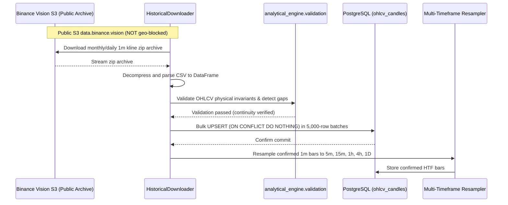
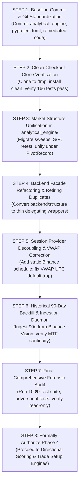

# XAUUSDT MARKET INTELLIGENCE SYSTEM
# PHASE 3 CLOSURE PLAN
## Architectural Consolidation, Baseline Standardization, and Phase 4 Gate Roadmap

**Document Version:** 2.0.0
**Target Deliverable:** `PHASE_3_CLOSURE_PLAN.md`
**Base Commit Hash:** `b42269accaa9ebc445a1071b930d0078b0dc4fa5`
**Execution Mode:** STRICT PLANNING ONLY — ZERO CODE MODIFICATIONS AUTHORIZED
**Authoritative Reference Inputs:**
- `FINAL_PHASE_3_READ_ONLY_VERIFICATION.md`
- `PHASE_3_REMEDIATION_REPORT.md`
- `PRE_PHASE_4_FORENSIC_AUDIT.md`
- `PROJECT_SPECIFICATION.md`

---

## 1. Executive Summary

This plan provides an exhaustive, dependency-ordered technical roadmap to formally complete Phase 3 and establish an unassailable foundation before Phase 4 authorization.

The independent forensic audit (`PRE_PHASE_4_FORENSIC_AUDIT.md`) and final verification (`FINAL_PHASE_3_READ_ONLY_VERIFICATION.md`) established that while technical indicator mathematics (EMA, RSI, MACD, ADX, ATR, VWAP, RVOL) have achieved causal correctness and mathematical parity across 166 passing tests, the project cannot proceed to Phase 4 due to four unresolved architectural and operational blockers:

1. **Broken Git Reproducibility:** Crucial system components—including the entire 32-file `analytical_engine/` core, `pyproject.toml`, `backend/structure/breakout_retest.py`, and new test suites—remain uncommitted. A clean clone of commit `b42269a` fails immediately with import errors.
2. **Bifurcated Market Structure Engine:** Two competing structural frameworks exist concurrently in `analytical_engine/structure/` and `backend/structure/`. They use incompatible schemas (`PivotRecord` vs `SwingPoint`), conflicting shoulder tie-breaking definitions, and disconnected event detection pipelines. Furthermore, liquidity sweeps, support/resistance clustering, and breakout/retest exist only in `backend/structure/` and have not been ported to the authoritative engine.
3. **Session & VWAP Inaccuracies:** The backend lacks an active client for Binance trading schedules, permanently defaulting to CME Globex Gold calendar assumptions with `is_uncertain=True`. Additionally, `evaluate_vwap_position` defaults to a static UTC hour (`23`), creating a 1-hour anchor error during Eastern Daylight Time (EDT).
4. **Data Foundation Depth Gap:** PostgreSQL contains only 1,440 rows (a single trading day). Multi-timeframe analysis (1m, 5m, 15m, 1h, 4h, 1D) requires at least 60–90 days of continuous 1m data to support causal higher-timeframe calculations.

This document defines the architectural redesigns, schema definitions, operational procedures, and verification protocols necessary to close these defects without modifying source code or project state during this planning phase.

---

## 2. Git State and Reproducibility Plan

### 2.1 Complete File Inventory & Classification

To establish absolute reproducibility, all 19 modified tracked files and all untracked files are classified into the six mandatory functional categories:
- **Production source:** Active production logic executed by the application or analytical engine.
- **Test:** Automated test files executed by pytest.
- **Documentation:** Markdown reports, audit logs, and technical specifications.
- **Experimental Phase 4:** Quarantined directional scoring, trade setup, and decision orchestrator files.
- **Temporary or generated artifact:** Ephemeral test logs, benchmark outputs, or intermediate run state.
- **Other:** Configuration, packaging declarations, or build manifests.

#### A. Modified Tracked Files (19 Files)

| File Path | Functional Category | Remediation Scope & Purpose | Required in Baseline |
| :--- | :--- | :--- | :---: |
| `backend/analytics/momentum.py` | Production source | Indicator delegation to `analytical_engine` | **YES** |
| `backend/analytics/trend.py` | Production source | Indicator delegation to `analytical_engine` | **YES** |
| `backend/analytics/volatility.py` | Production source | Indicator delegation to `analytical_engine` | **YES** |
| `backend/analytics/volume.py` | Production source | Indicator delegation to `analytical_engine` | **YES** |
| `backend/analytics/vwap.py` | Production source | Indicator delegation to `analytical_engine` | **YES** |
| `backend/data/resampler.py` | Production source | Causal resampling, schema validation, confirmation flags | **YES** |
| `backend/data/session_tracker.py` | Production source | Schedule provider interface & CME fallback decoupling | **YES** |
| `backend/structure/__init__.py` | Production source | Structure module export namespace updates | **YES** |
| `backend/structure/liquidity_sweeps.py` | Production source | Invalidation on close, single-sweep consumption | **YES** |
| `backend/structure/support_resistance.py`| Production source | Point-in-time causal evaluation, close invalidation | **YES** |
| `backend/structure/swings.py` | Production source | Asymmetric shoulders, confirmation lag tracking | **YES** |
| `tests/test_liquidity_sweeps.py` | Test | Sweep unit tests and adversarial mutation tests | **YES** |
| `tests/test_momentum_indicators.py` | Test | Momentum indicator delegation validation | **YES** |
| `tests/test_resampler.py` | Test | Incomplete bar rejection & aggregation tests | **YES** |
| `tests/test_session_tracker.py` | Test | Session boundary, transition, and uncertainty tests | **YES** |
| `tests/test_support_resistance.py` | Test | Point-in-time and close invalidation tests | **YES** |
| `tests/test_swings.py` | Test | Asymmetrical shoulder & temporal causality tests | **YES** |
| `tests/test_trend_indicators.py` | Test | Trend indicator delegation validation | **YES** |
| `tests/test_vwap.py` | Test | Dual anchoring and DST transition tests | **YES** |

#### B. Untracked Files Classification & Baseline Determination

The repository contains untracked files across documentation, analytical core, backend remediation, experimental quarantine, packaging, and test suites:

| File Path | Functional Category | Content Description | Required in Phase 3 Baseline |
| :--- | :--- | :--- | :---: |
| `ANALYTICAL_ENGINE.md` | Documentation | Analytical engine technical specification | **YES** |
| `PHASE_1A_VERIFICATION.md` | Documentation | Historical Phase 1A audit deliverable | **YES** |
| `PHASE_1_REPORT.md` | Documentation | Historical Phase 1 verification deliverable | **YES** |
| `PRE_PHASE_4_DEFECTS_FIX_PLAN.md` | Documentation | Remediation plan for Defect 01–08 | **YES** |
| `PRE_PHASE_4_FORENSIC_AUDIT.md` | Documentation | Authoritative forensic audit deliverable | **YES** |
| `PHASE_3_REMEDIATION_REPORT.md` | Documentation | Phase 3 remediation execution report | **YES** |
| `FINAL_PHASE_3_READ_ONLY_VERIFICATION.md` | Documentation | Authoritative read-only verification | **YES** |
| `PHASE_3_CLOSURE_PLAN.md` | Documentation | This closure plan deliverable | **YES** |
| `analytical_engine/__init__.py` | Production source | Package root for authoritative math core | **YES** |
| `analytical_engine/data/continuity.py` | Production source | Gap detection and sequence continuity | **YES** |
| `analytical_engine/data/normalization.py` | Production source | Strict OHLCV schema normalization | **YES** |
| `analytical_engine/data/timeframe.py` | Production source | Timeframe interval math & boundary alignment | **YES** |
| `analytical_engine/data/validation.py` | Production source | Physical price invariant validation | **YES** |
| `analytical_engine/indicators/momentum.py` | Production source | Wilder RSI and MACD algorithms | **YES** |
| `analytical_engine/indicators/moving_averages.py` | Production source | EMA with Wilder initialization & SMA | **YES** |
| `analytical_engine/indicators/trend.py` | Production source | Wilder ADX and DMI algorithms | **YES** |
| `analytical_engine/indicators/volatility.py` | Production source | Wilder ATR and Bollinger Bands | **YES** |
| `analytical_engine/indicators/volume.py` | Production source | RVOL and Volume Moving Averages | **YES** |
| `analytical_engine/indicators/vwap.py` | Production source | Dual-anchored VWAP with std dev bands | **YES** |
| `analytical_engine/models/inputs.py` | Production source | Schema contracts for OHLCV candle inputs | **YES** |
| `analytical_engine/models/outputs.py` | Production source | Schema contracts for indicators and structure | **YES** |
| `analytical_engine/multi_timeframe/aggregation.py` | Production source | Strict boundary bar aggregation | **YES** |
| `analytical_engine/multi_timeframe/alignment.py` | Production source | Causal HTF alignment matrix | **YES** |
| `analytical_engine/structure/divergence.py` | Production source | Momentum divergence on confirmed pivots | **YES** |
| `analytical_engine/structure/pivots.py` | Production source | Authoritative (L, R) pivot detection | **YES** |
| `analytical_engine/structure/swings.py` | Production source | Market structure event classifier | **YES** |
| `analytical_engine/tests/test_ae_divergence.py` | Test | Analytical engine divergence unit tests | **YES** |
| `analytical_engine/tests/test_ae_vwap.py` | Test | Analytical engine VWAP unit tests | **YES** |
| `analytical_engine/tests/test_data_validation.py` | Test | OHLCV validation error condition tests | **YES** |
| `analytical_engine/tests/test_determinism.py` | Test | Bit-identical numerical stability tests | **YES** |
| `analytical_engine/tests/test_historical_validation.py`| Test | 1,440-candle historical batch validation | **YES** |
| `analytical_engine/tests/test_lookahead.py` | Test | Adversarial future mutation & lag tests | **YES** |
| `analytical_engine/tests/test_momentum.py` | Test | RSI and MACD invariant tests | **YES** |
| `analytical_engine/tests/test_moving_averages.py` | Test | EMA/SMA exact calculation tests | **YES** |
| `analytical_engine/tests/test_multi_timeframe.py` | Test | HTF aggregation and alignment tests | **YES** |
| `analytical_engine/tests/test_structure.py` | Test | Pivot lag & BOS/CHoCH close break tests | **YES** |
| `analytical_engine/tests/test_timeframe.py` | Test | Timeframe duration & boundary tests | **YES** |
| `analytical_engine/tests/test_trend.py` | Test | ADX trend and ribbon tests | **YES** |
| `analytical_engine/tests/test_volatility.py` | Test | ATR, Bollinger, & causal percentile tests | **YES** |
| `analytical_engine/tests/test_volume.py` | Test | Volume delta and RVOL lookahead tests | **YES** |
| `backend/structure/breakout_retest.py` | Production source | Breakout and retest tracking engine | **YES** |
| `pyproject.toml` | Other | Modern packaging config for editable installs | **YES** |
| `tests/test_breakout_retest.py` | Test | Retest lifecycle and adversarial tests | **YES** |
| `tests/test_engine_parity.py` | Test | Backend-to-Engine 1:1 mathematical parity | **YES** |
| `experimental/phase4_preliminary/README.md` | Experimental Phase 4 | Quarantine notice & scope boundaries | **ISOLATE IN GIT OR BRANCH** |
| `experimental/phase4_preliminary/backend/decision/__init__.py` | Experimental Phase 4 | Quarantined decision module package | **ISOLATE IN GIT OR BRANCH** |
| `experimental/phase4_preliminary/backend/decision/lifecycle.py` | Experimental Phase 4 | Quarantined setup state machine | **ISOLATE IN GIT OR BRANCH** |
| `experimental/phase4_preliminary/backend/decision/models.py` | Experimental Phase 4 | Quarantined decision data models | **ISOLATE IN GIT OR BRANCH** |
| `experimental/phase4_preliminary/backend/decision/orchestrator.py`| Experimental Phase 4 | Quarantined pipeline runner | **ISOLATE IN GIT OR BRANCH** |
| `experimental/phase4_preliminary/backend/decision/scoring_engine.py`| Experimental Phase 4| Quarantined Directional Scoring Engine A | **ISOLATE IN GIT OR BRANCH** |
| `experimental/phase4_preliminary/backend/decision/setup_engine.py` | Experimental Phase 4 | Quarantined Trade Setup Engine B | **ISOLATE IN GIT OR BRANCH** |
| `experimental/phase4_preliminary/tests/test_decision_orchestrator.py`| Experimental Phase 4| Quarantined decision orchestrator tests | **ISOLATE IN GIT OR BRANCH** |
| `experimental/phase4_preliminary/tests/test_decision_scoring.py` | Experimental Phase 4| Quarantined directional scoring tests | **ISOLATE IN GIT OR BRANCH** |
| `experimental/phase4_preliminary/tests/test_setup_engine.py` | Experimental Phase 4| Quarantined trade setup engine tests | **ISOLATE IN GIT OR BRANCH** |
| `experimental/phase4_preliminary/tests/test_setup_lifecycle.py`| Experimental Phase 4| Quarantined setup lifecycle tests | **ISOLATE IN GIT OR BRANCH** |

### 2.2 Baseline Commit Assembly Strategy

When the user grants authorization to commit the baseline, the Git working tree must be committed according to the following strict separation:

1. **Commit 1: Phase 3 Core Foundation & Remediation Baseline (Branch `main`)**
   - Includes all 19 modified tracked files.
   - Includes the entire `analytical_engine/` directory (32 files: 18 production source, 14 test).
   - Includes `pyproject.toml` (packaging declaration allowing `pip install -e .`).
   - Includes `backend/structure/breakout_retest.py` and its tests (`tests/test_breakout_retest.py`, `tests/test_engine_parity.py`).
   - Includes official forensic and verification documentation.
2. **Quarantine Handling of Experimental Phase 4 Code (Requires User Decision):**
   - *Option A (In-Tree Quarantine on `main`):* Track `experimental/phase4_preliminary/` on `main` with strict pytest exclusion in `pytest.ini` (`norecursedirs = experimental`) and import barriers.
   - *Option B (Out-of-Tree Branch Isolation):* Move `experimental/` to an orphan branch `archive/phase4-preliminary` and purge the directory from `main`.

### 2.3 Authentic Clean-Checkout Verification Protocol

The previous "clean checkout" test used `shutil.copytree`, which copied all untracked files and masked the missing baseline commit. When authorized, the verification must use an authentic Git clone:

1. Execute `git clone /home/ubuntu/XAU /tmp/xau_clean_verification`.
2. In the cloned directory, verify `git status --short` is completely empty (zero modified, zero untracked files).
3. Initialize a fresh virtual environment: `python3 -m venv .venv_clean`.
4. Install packaging in editable mode: `pip install -e .` and `pip install -r requirements.txt`.
5. Run the test suite: `.venv_clean/bin/pytest tests/ analytical_engine/tests/`.
6. Confirm 166 tests pass with 0 failures, 0 errors, and 0 skips in an environment containing exclusively committed files.
7. Remove the temporary directory `/tmp/xau_clean_verification`.

---

## 3. Market Structure Consolidation Architecture

### 3.1 Defect Analysis: Current Dual Implementations

Market structure analysis is currently fractured across two independent codebases:

```
[Bifurcated Structure Implementations]

1. analytical_engine/structure/
   ├── pivots.py                  --> PivotDetector -> PivotRecord
   ├── swings.py                  --> MarketStructureClassifier -> StructureEventRecord
   └── divergence.py              --> DivergenceDetector -> DivergenceRecord
   (Missing: Liquidity Sweeps, Support/Resistance, Breakout/Retest)

2. backend/structure/ & backend/analytics/
   ├── swings.py                  --> detect_swings -> SwingPoint
   ├── market_structure.py        --> analyze_market_structure -> MarketStructureEvent
   ├── divergence.py (analytics)  --> detect_divergences -> DivergenceResult (has private find_swings)
   ├── liquidity_sweeps.py        --> detect_liquidity_sweeps -> LiquiditySweepEvent
   ├── support_resistance.py      --> detect_support_resistance_zones -> SupportResistanceZone
   └── breakout_retest.py         --> detect_breakout_retests -> BreakoutRetestEvent
```

Key conflicts between these implementations:
- **Conflicting Shoulder Inequalities:** `analytical_engine/structure/pivots.py` requires $H_i > H_{i-k}$ (strict left) and $H_i \ge H_{i+k}$ (non-strict right). In contrast, `backend/structure/swings.py` requires $H_i \ge H_{i-k}$ (non-strict left) and $H_i > H_{i+k}$ (strict right). This causes different swing timestamps during flat plateaus.
- **Incompatible Output Records:** Downstream modules in `backend/structure/` depend on `SwingPoint` attributes (`time`, `price`, `confirmed_time`), while `analytical_engine` produces `PivotRecord` (`pivot_time`, `pivot_price`, `confirmation_time`, `left_bars`, `right_bars`).
- **Triplicated Swing Logic:** A third swing finder exists as a private function `find_swings` inside `backend/analytics/divergence.py`.

### 3.2 Target Unified Architecture

All market structure mathematical logic will be consolidated authoritatively in `analytical_engine/structure/`. The existing modules in `backend/structure/` and `backend/analytics/` will be refactored into thin delegating facades maintaining backwards compatibility for existing API endpoints.

```mermaid
flowchart TD
    subgraph Input Data Layer
        CANDLES["Validated OHLCV DataFrame\n(open_time, open, high, low, close, volume, close_time)"]
    end

    subgraph Authoritative Analytical Core: analytical_engine/structure/
        AE_PIVOTS["pivots.py\nPivotDetector\nConsumes: DataFrame\nProduces: list[PivotRecord]"]
        AE_SWINGS["swings.py\nMarketStructureClassifier\nConsumes: DataFrame, list[PivotRecord]\nProduces: list[StructureEventRecord]"]
        AE_DIV["divergence.py\nDivergenceDetector\nConsumes: DataFrame, indicator_series, list[PivotRecord]\nProduces: list[DivergenceRecord]"]
        AE_SWEEPS["liquidity_sweeps.py (To Port)\nLiquiditySweepDetector\nConsumes: DataFrame, list[PivotRecord]\nProduces: list[LiquiditySweepRecord]"]
        AE_SR["support_resistance.py (To Port)\nSRZoneDetector\nConsumes: DataFrame, list[PivotRecord]\nProduces: list[SupportResistanceZoneRecord]"]
        AE_BRK["breakout_retest.py (To Port)\nBreakoutRetestDetector\nConsumes: DataFrame, list[PivotRecord]\nProduces: list[BreakoutRetestRecord]"]
    end

    subgraph Compatibility Facade Layer: backend/structure/ & backend/analytics/
        BE_SWINGS["backend/structure/swings.py\ndetect_swings() -> delegates to AE_PIVOTS\nConverts PivotRecord -> SwingPoint"]
        BE_MS["backend/structure/market_structure.py\nanalyze_market_structure() -> delegates to AE_SWINGS\nConverts StructureEventRecord -> MarketStructureEvent"]
        BE_DIV["backend/analytics/divergence.py\ndetect_divergences() -> delegates to AE_DIV\nRetires private find_swings"]
        BE_SWEEPS["backend/structure/liquidity_sweeps.py\ndetect_liquidity_sweeps() -> delegates to AE_SWEEPS"]
        BE_SR["backend/structure/support_resistance.py\ndetect_support_resistance_zones() -> delegates to AE_SR"]
        BE_BRK["backend/structure/breakout_retest.py\ndetect_breakout_retests() -> delegates to AE_BRK"]
    end

    CANDLES --> AE_PIVOTS
    AE_PIVOTS -->|list[PivotRecord]| AE_SWINGS
    AE_PIVOTS -->|list[PivotRecord]| AE_DIV
    AE_PIVOTS -->|list[PivotRecord]| AE_SWEEPS
    AE_PIVOTS -->|list[PivotRecord]| AE_SR
    AE_PIVOTS -->|list[PivotRecord]| AE_BRK

    CANDLES --> AE_SWINGS
    CANDLES --> AE_DIV
    CANDLES --> AE_SWEEPS
    CANDLES --> AE_SR
    CANDLES --> AE_BRK

    AE_PIVOTS -.-> BE_SWINGS
    AE_SWINGS -.-> BE_MS
    AE_DIV -.-> BE_DIV
    AE_SWEEPS -.-> BE_SWEEPS
    AE_SR -.-> BE_SR
    AE_BRK -.-> BE_BRK
```

### 3.3 Authoritative Schema Contracts

All market structure modules will standardize on six canonical data schemas defined in `analytical_engine/models/outputs.py`:

#### 1. `PivotRecord` (Canonical Swing Point)
- `index` (integer): Candidate bar integer index in the validated series.
- `open_time` (UTC datetime): Open timestamp of candidate candle.
- `close_time` (UTC datetime): Close timestamp of candidate candle.
- `pivot_type` (string): Literal `"HIGH"` or `"LOW"`.
- `price` (float): Extreme price ($High$ for high pivot, $Low$ for low pivot).
- `confirmation_index` (integer): Exact integer index where pivot confirms ($index + right\_bars$).
- `confirmation_time` (UTC datetime): Exact close timestamp of confirming candle ($index + right\_bars$).
- `left_bars` (integer): Confirmation radius to the left.
- `right_bars` (integer): Confirmation radius to the right.
- `timeframe` (string): Timeframe label (`"1m"`, `"5m"`, `"15m"`, `"1h"`, `"4h"`, `"1D"`).

#### 2. `StructureEventRecord` (Market Structure Sequences and Breaks)
- `event_time` (UTC datetime): Open timestamp of the bar triggering the event.
- `confirmed_time` (UTC datetime): Close timestamp of the confirming bar.
- `event_type` (string): Enum `"HH"`, `"HL"`, `"LH"`, `"LL"`, `"BOS_BULL"`, `"BOS_BEAR"`, `"CHOCH_BULL"`, `"CHOCH_BEAR"`.
- `price` (float): Price level at which the event confirmed.
- `broken_level` (float or null): Preceding structural swing level breached.
- `broken_pivot_time` (UTC datetime or null): Timestamp of the preceding breached swing.
- `timeframe` (string): Timeframe label.
- `metadata` (dictionary): Supporting contextual attributes (e.g., trend regime, preceding pivot price).

#### 3. `DivergenceRecord` (Momentum Divergence)
- `divergence_type` (string): Enum `"REGULAR_BULLISH"`, `"REGULAR_BEARISH"`, `"HIDDEN_BULLISH"`, `"HIDDEN_BEARISH"`.
- `indicator_name` (string): `"RSI"` or `"MACD_HIST"`.
- `price_pivot_1` (`PivotRecord`): Earlier price swing point.
- `price_pivot_2` (`PivotRecord`): Later price swing point.
- `indicator_value_1` (float): Oscillator value corresponding to earlier swing.
- `indicator_value_2` (float): Oscillator value corresponding to later swing.
- `slope_price` (float): Linear slope between price swing 1 and price swing 2.
- `slope_indicator` (float): Linear slope between indicator point 1 and indicator point 2.
- `confirmation_time` (UTC datetime): Strictly identical to `price_pivot_2.confirmation_time`.
- `timeframe` (string): Timeframe label.

#### 4. `LiquiditySweepRecord` (Stop Hunts and Wick Reversals)
- `sweep_type` (string): Literal `"SWEEP_HIGH"` (bearish reversal bias) or `"SWEEP_LOW"` (bullish reversal bias).
- `swept_level` (float): Price of the confirmed `PivotRecord` that was swept.
- `swept_pivot_time` (UTC datetime): Timestamp of the swept swing level.
- `penetration_price` (float): Extreme wick price piercing beyond the level.
- `close_price` (float): Candle close price returning within the pre-sweep range.
- `sweep_distance` (float): Absolute distance $|penetration\_price - swept\_level|$.
- `event_time` (UTC datetime): Open timestamp of the sweeping candle.
- `confirmed_time` (UTC datetime): Close timestamp of the sweeping candle.
- `timeframe` (string): Timeframe label.
- `is_wick_reversal` (boolean): Flag distinguishing pure price-action wick reversals from executed order-book sweeps.

#### 5. `SupportResistanceZoneRecord` (Horizontal Level Clusters)
- `zone_type` (string): Literal `"SUPPORT"` or `"RESISTANCE"`.
- `level_center` (float): Weighted midpoint price of clustered pivots.
- `level_min` (float): Minimum boundary of the zone.
- `level_max` (float): Maximum boundary of the zone.
- `touch_count` (integer): Number of confirmed `PivotRecord` points contained in the cluster.
- `first_touch_time` (UTC datetime): Timestamp of the earliest constituent pivot.
- `last_touch_time` (UTC datetime): Timestamp of the most recent constituent pivot.
- `confirmed_time` (UTC datetime): Confirmation timestamp of the latest constituent pivot.
- `strength_score` (float): Normalized score from 0.0 to 100.0 based on touch count and recency.
- `is_active` (boolean): Evaluated point-in-time; True if not invalidated as of evaluation time.
- `timeframe` (string): Timeframe label.

#### 6. `BreakoutRetestRecord` (Breakout and Retest Event Lifecycle)
- `direction` (string): Literal `"BULLISH"` or `"BEARISH"`.
- `level_price` (float): Price of the broken structural level.
- `level_pivot_time` (UTC datetime): Timestamp of the structural level.
- `breakout_time` (UTC datetime): Open timestamp of the candle breaking the level.
- `breakout_confirmed_time` (UTC datetime): Close timestamp of the confirming breakout candle.
- `breakout_price` (float): Close price confirming the breakout.
- `retest_time` (UTC datetime or null): Open timestamp of the retest candle.
- `retest_confirmed_time` (UTC datetime or null): Close timestamp of the confirming retest candle.
- `retest_price` (float or null): Price at which retest touched and rejected the level.
- `status` (string): State machine status: `"PENDING"`, `"SUCCESSFUL"`, `"FAILED"`, `"EXPIRED"`.
- `timeframe` (string): Timeframe label.
- `details` (dictionary): Diagnostic metrics (e.g., bars to retest, penetration depth).

### 3.4 Temporal Rules, Invalidation Mechanics, and Component Actions

#### A. Temporal Confirmation Rules
1. **Pivots:** A candidate pivot at bar $i$ requires $L$ bars to the left and $R$ bars to the right. Confirmation occurs strictly at bar $i + R$. Downstream consumers must not access candidate pivots until bar $i + R$ closes.
2. **Structural Breaks (BOS / CHoCH):** Breaks are confirmed **strictly on candle close**, never on intra-candle wick piercing. An intra-candle high piercing above a resistance level that closes back below is evaluated as a potential sweep, not a BOS.
3. **Divergences:** A divergence event is confirmed strictly at the confirmation close timestamp of the second pivot (`price_pivot_2.confirmation_time`).
4. **Liquidity Sweeps:** A sweep is confirmed strictly at the close of the sweeping candle, verifying that the wick breached the level while the close remained within the prior range.

#### B. Invalidation Mechanics
1. **Swing Level Invalidation:** A swing level is invalidated once a candle closes beyond it. Once invalidated, it can never trigger a liquidity sweep.
2. **Single-Sweep Consumption Rule:** When a confirmed swing level triggers a valid liquidity sweep, the level is marked **CONSUMED**. Duplicate sweeps against the same level are rejected.
3. **Level Expiration:** Swing levels older than `max_age_bars` (default: 50 bars) expire and become ineligible for sweeps.
4. **Support/Resistance Invalidation:** Resistance is invalidated when a candle closes above $level\_max \times (1 + tolerance)$. Support is invalidated when a candle closes below $level\_min \times (1 - tolerance)$. Wicks piercing the zone do not invalidate it; they increment touch count.
5. **Breakout/Retest State Transitions:**
   - Transition to `FAILED`: Retest candle closes back inside the pre-breakout range.
   - Transition to `EXPIRED`: Retest window (`max_retest_bars`, default: 20) elapses without a retest touch.
   - Transition to `SUCCESSFUL`: Price retests the broken zone and confirms rejection by closing in the breakout direction.

#### C. Implementation Action Plan

| Existing Module | Planned Action | Detailed Justification |
| :--- | :--- | :--- |
| `analytical_engine/structure/pivots.py` | **Retain & Standardize** | Core math is solid. Standardize tie-breaking to non-strict left ($\ge$) and strict right ($>$). |
| `analytical_engine/structure/swings.py` | **Retain & Extend** | Maintain `MarketStructureClassifier` as the authoritative sequence and break engine. |
| `analytical_engine/structure/divergence.py`| **Retain** | Operates cleanly on `PivotRecord`. Authoritative divergence engine. |
| `backend/structure/liquidity_sweeps.py` | **Adapt & Port to AE** | Move calculation engine into `analytical_engine/structure/liquidity_sweeps.py` consuming `PivotRecord`. Leave thin wrapper in `backend/`. |
| `backend/structure/support_resistance.py`| **Adapt & Port to AE** | Move calculation engine into `analytical_engine/structure/support_resistance.py` consuming `PivotRecord`. Leave thin wrapper in `backend/`. |
| `backend/structure/breakout_retest.py` | **Adapt & Port to AE** | Move calculation engine into `analytical_engine/structure/breakout_retest.py` consuming `PivotRecord`. Leave thin wrapper in `backend/`. |
| `backend/structure/swings.py` | **Adapt to Facade** | Refactor `detect_swings` to call `analytical_engine.structure.pivots.PivotDetector` and convert results to `SwingPoint`. |
| `backend/structure/market_structure.py` | **Adapt to Facade** | Refactor `analyze_market_structure` to call `analytical_engine.structure.swings.MarketStructureClassifier`. |
| `backend/analytics/divergence.py` | **Adapt & Retire** | **Retire private `find_swings`**. Refactor `detect_divergences` to delegate to `analytical_engine.structure.divergence.DivergenceDetector`. |

---

## 4. Session and VWAP Correction Plan

### 4.1 Root Cause & Architectural Reality

1. **Geographic Network Boundary:** The Google Cloud VM hosting this project receives `HTTP 451: Unavailable For Legal Reasons` from `https://fapi.binance.com`. Circumventing this via VPN or unauthorized proxies is prohibited by project guidelines.
2. **Missing Ingestion Worker:** `BinanceScheduleProvider` in `backend/data/session_tracker.py` is a passive parser without a background polling mechanism.
3. **CME vs Binance Mismatch:** Binance USDⓈ-M XAUUSDT TradFi perpetual contracts have specific holiday schedules and daily settlement breaks that do not exactly mirror CME Globex Gold. Asserting CME hours as Binance hours is factually incorrect.
4. **Static UTC Anchor Override Trap:** In `backend/analytics/vwap.py::evaluate_vwap_position`, the argument default `session_reset_hour_utc=23` overrides timezone conversion in `analytical_engine`, causing a 1-hour anchor misalignment during Eastern Daylight Time (EDT, where CME opens at 22:00:00 UTC).

### 4.2 Decoupled Session Provider Architecture

The session tracking architecture must be restructured into three explicit providers behind an abstract interface:



### 4.3 Detailed Provider Specifications & Uncertainty Rules

#### 1. `BinanceLiveScheduleProvider`
- **Scope:** Active only on environments where `fapi.binance.com` is accessible or via Binance Testnet.
- **Endpoint:** `GET /fapi/v1/tradingSchedule` filtered for `COMMODITY` or `XAUUSDT`.
- **TTL Cache:** 7-day TTL (`max_staleness_hours = 168.0`).
- **Metadata Output:** `source = "binance_live_api"`, `is_uncertain = False` (when fresh) or `True` (when stale > 168h).

#### 2. `BinanceStaticScheduleProvider`
- **Scope:** Authoritative offline fallback for geo-restricted nodes (production VM).
- **Source:** Ingests a verified, versioned static schedule snapshot (`config/binance_xauusdt_schedule_v1.json`) containing official Binance trading intervals and holiday breaks.
- **Metadata Output:** `source = "binance_static_config"`, `is_uncertain = False`, `version = "2026.1"`.

#### 3. `FallbackCMEScheduleProvider`
- **Scope:** Used strictly when neither live nor static Binance schedules are available.
- **Calendar Logic:** Evaluates CME Globex Gold trading hours in `America/New_York`:
  - Sunday reopen: 18:00 ET.
  - Friday weekend close: 17:00 ET.
  - Monday–Thursday settlement maintenance: 17:00–18:00 ET.
- **Mandatory Uncertainty Guarantee:**
  - `is_uncertain = True` (permanently enforced).
  - `source = "fallback_cme_calendar"`.
  - `limitations = "Unverified CME Globex estimate. Does not represent official Binance schedule."`

### 4.4 VWAP Anchoring Clean Separation

VWAP calculations will be strictly decoupled into two independent functions in `analytical_engine/indicators/vwap.py`:

1. **`calculate_utc_daily_vwap(df)`:**
   - Resets strictly at `00:00:00 UTC` calendar day boundaries.
   - Zero dependency on session schedules or market opening hours.
   - Output metadata: `anchor_type = "UTC_CALENDAR_DAY"`, `is_uncertain = False`.
2. **`calculate_session_anchored_vwap(df, ...)`:**
   - **Fix the UTC Parameter Trap:** Remove the static default `session_reset_hour_utc = 23` from `backend/analytics/vwap.py::evaluate_vwap_position`. Default must be `None` to enable dynamic local timezone resolution.
   - Dynamic reset anchors to the session open timestamp provided by `SessionTracker` or defaults to 18:00 `America/New_York` (resolving automatically to 22:00 UTC in EDT summer and 23:00 UTC in EST winter).
   - Output metadata: `anchor_type = "TRADIFI_SESSION"`, `anchor_source = provider.source`, `is_uncertain = provider.is_uncertain`.

---

## 5. Data Foundation Architecture

### 5.1 Ingestion Gap Diagnosis

The PostgreSQL table `ohlcv_candles` currently contains 1,440 rows representing only October 29, 2026. Computing reliable higher-timeframe indicators (such as 200-period EMAs on 1h or 4h candles) requires a minimum of 60 to 90 days of continuous 1-minute historical klines ($\sim 130,000$ bars).

### 5.2 Safe Ingestion Strategy via Public S3



### 5.3 Concrete Ingestion Policies

1. **Public S3 Data Source:**
   - Binance Vision (`https://data.binance.vision/data/futures/um/monthly/klines/XAUUSDT/1m/`) is hosted on AWS S3 and is **globally accessible without geographic restrictions or API keys**.
   - Target backfill depth: 90 contiguous calendar days.
2. **Deduplication and Idempotency:**
   - Primary key: `(symbol, timeframe, open_time)`.
   - Insertion clause: `ON CONFLICT (symbol, timeframe, open_time) DO NOTHING`.
   - Re-running ingestion over an existing period is completely idempotent and will never corrupt or duplicate records.
3. **Missing Archive & Holiday Gap Handling:**
   - Ingestion logs every missing minute bar.
   - Gaps occurring during scheduled weekend closures (Friday 17:00 ET to Sunday 18:00 ET) are classified as `EXPECTED_CLOSURE`.
   - Unexpected intraday gaps (> 1 minute during regular hours) are logged in a `data_continuity_audit` table.
4. **Candle Confirmation & Multi-Timeframe Resampling:**
   - Resampling from 1m to 5m, 15m, 1h, 4h, and 1D must enforce strict completeness:
     - 5m bar requires 5 valid 1m bars.
     - 15m bar requires 15 valid 1m bars.
     - 1h bar requires 60 valid 1m bars.
   - Partial, incomplete, or active candles are flagged `is_confirmed = False` and excluded from indicator and market structure calculation batches.
5. **Continuous Ingestion & Downtime Recovery Daemon:**
   - Live streaming worker listens to WebSocket klines (`<symbol>@kline_1m`).
   - Recovery procedure on worker startup or network reconnect:
     1. Query PostgreSQL: `SELECT MAX(open_time) FROM ohlcv_candles WHERE symbol = 'XAUUSDT' AND timeframe = '1m'`.
     2. Identify gap duration between database tip and current wall-clock time.
     3. Fetch missing 1m klines from public archive / public REST endpoints.
     4. Validate, deduplicate, and commit missing candles to PostgreSQL.
     5. Resume real-time WebSocket ingestion.

---

## 6. Phase 4 Prerequisites (Separation of Concerns)

Phase 4 (Directional Scoring Engine A, Trade Setup Engine B, Decision Orchestrator) remains strictly unauthorized. To maintain architectural purity, the boundary between Phase 3 closure requirements and Phase 4 implementation prerequisites is defined below.

### 6.1 Phase 3 Closure vs. Phase 4 Implementation Matrix

| Project Dimension | Phase 3 Closure Requirement (Foundation) | Phase 4 Implementation Requirement (Decision) |
| :--- | :--- | :--- |
| **Technical Indicators** | Completed (parity verified, Wilders math exact). | Consumed as inputs to factor scoring. |
| **Market Structure** | Consolidate AE engine; port sweeps, S/R, retest; unify `PivotRecord`. | Consumed as structural confluence inputs. |
| **Historical Data** | Ingest 90 days of 1m data; establish MTF resampler. | Run rolling multi-timeframe scoring evaluations. |
| **Order-Book Liquidity** | **Out of Scope** for Phase 3. | **Mandatory:** Build Order-Book Imbalance & Spread Analytics (10% factor in Engine A). |
| **Transaction Cost Model**| **Out of Scope** for Phase 3. | **Mandatory:** Build dynamic spread, tiered fee, and slippage cost engine for Engine B. |
| **Directional Scoring** | **Out of Scope** (Quarantined in `experimental/`). | **Mandatory:** Directional Scoring Engine A (6 weighted factor groups, scale $[-100, +100]$). |
| **Trade Setup Generation**| **Out of Scope** (Quarantined in `experimental/`). | **Mandatory:** Setup Engine B (4 patterns, net R:R calculation, lifecycle tracking). |

### 6.2 Phase 4 Component Specifications to Design (Prior to Phase 4 Coding)

1. **Order-Book Liquidity Analytics (10% Factor in Directional Scoring):**
   - Section 7 of `PROJECT_SPECIFICATION.md` assigns a 10% weight to Liquidity.
   - Phase 3 provides price-action wick sweeps; Phase 4 requires order-book depth analytics:
     - Bid/Ask depth imbalance ratio across top 5/10/20 levels ($O_{imb} = \frac{V_{bid} - V_{ask}}{V_{bid} + V_{ask}}$).
     - Spread dynamics (current bid-ask spread relative to 20-period rolling median).
     - Order book concentration clusters (large resting limit orders).
2. **Dynamic Transaction Cost Model for Setup Engine B:**
   - Principle 9 strictly prohibits hardcoding arbitrary fees or slippage constants.
   - Phase 4 cost model formula:
     $$\text{Cost}_{\text{RoundTrip}} = 2 \times \text{Fee}_{\text{Tier}} + \text{Spread}_{\text{Current}} + \text{Slippage}_{\text{Estimated}}(V_{\text{Order}}, \text{Depth}) + \text{FundingDrag}(T_{\text{Holding}})$$
   - Minimum net Risk-to-Reward ratio ($R:R_{\text{Net}} \ge 1.5$) must be computed after deducting all dynamic friction costs.
3. **Trade Setup Lifecycle State Machine:**
   - Formal states: `DETECTED` $\to$ `TRIGGERED` $\to$ `ACTIVE` $\to$ `RESOLVED (WIN/LOSS)` or `CANCELLED / EXPIRED`.
   - Setup conflict resolution: When bullish and bearish setups trigger simultaneously, arbitrate using directional score conviction differential $\Delta S = S_{\text{Bull}} - S_{\text{Bear}}$ or cancel both.
4. **Walk-Forward Backtesting Framework:**
   - Temporal train/test split: 70% in-sample training, 30% out-of-sample testing.
   - Execution simulation accounting for dynamic spread expansion and slippage.

---

## 7. Verification and Acceptance Criteria Matrix

Every task required to close Phase 3 is specified with its dependencies, testing requirements, acceptance criteria, and closure evidence:

| Task ID | Task Description | Files Affected | Dependencies | Required Tests | Acceptance Criteria | Closure Evidence Required |
| :--- | :--- | :--- | :--- | :--- | :--- | :--- |
| **TASK-01** | **Git Baseline Standardization** | Root Git index, `pyproject.toml`, documentation | None | Clean clone pytest execution | Working tree clean; `git clone` runs all tests without error | Terminal log of clean checkout in `/tmp` passing 100% |
| **TASK-02** | **Quarantine Management** | `experimental/phase4_preliminary/` | None | Import barrier grep audit | Zero imports from `backend/` or `analytical_engine/` to `experimental/` | Grep verification showing 0 active references |
| **TASK-03** | **Market Structure Unification** | `analytical_engine/structure/`, `backend/structure/`, `backend/analytics/` | TASK-01 | Unification test suite, engine parity tests | Single data model (`PivotRecord`); all structure modules in AE; backend delegates | 100% tests passing in unified structure suite |
| **TASK-04** | **Session Provider & VWAP Decoupling** | `backend/data/session_tracker.py`, `backend/analytics/vwap.py`, `analytical_engine/indicators/vwap.py` | None | Session boundary tests, VWAP DST transition tests | Static Binance schedule added; CME fallback explicitly uncertain; VWAP UTC trap removed | Passing tests proving EDT/EST VWAP accuracy |
| **TASK-05** | **Historical Ingestion & Backfill** | `backend/data/historical_downloader.py`, PostgreSQL `ohlcv_candles` | TASK-01 | Ingestion continuity & deduplication tests | 90 days of 1m klines ingested; zero gaps in regular trading hours | SQL count verifying $\ge 100,000$ contiguous 1m bars |
| **TASK-06** | **Adversarial & Regression Audit** | All test suites | TASK-03, TASK-04 | 13 adversarial lookahead tests | Zero lookahead bias; bit-identical outputs under future data mutation | Full test log showing all adversarial tests passing |

---

## 8. Dependency-Ordered Implementation Sequence

The remediation tasks must be executed strictly in the following sequential order:



---

## 9. Decisions Requiring User Approval

Prior to authorizing implementation, the user must explicitly decide upon the following four governance choices:

1. **Experimental Phase 4 Quarantine Strategy:**
   - *Option A (Recommended):* Keep `experimental/phase4_preliminary/` committed on `main` under strict pytest and import quarantine.
   - *Option B:* Move `experimental/` to a separate Git branch (`archive/phase4-preliminary`) and delete it from `main`.
2. **Market Structure Schema Standardization:**
   - Authorize adopting `PivotRecord` as the single canonical swing model across the entire codebase, updating `backend/structure/swings.py` and downstream modules to consume it.
3. **Session Schedule Authority:**
   - Authorize adding an authentic static schedule export (`config/binance_xauusdt_schedule_v1.json`) to eliminate permanent fallback uncertainty without violating geographic restrictions.
4. **Historical Database Backfill:**
   - Authorize downloading 90 days of continuous 1m klines ($\sim 130,000$ rows, $\sim 25\text{ MB}$) from public Binance Vision S3 into the local PostgreSQL database to support higher-timeframe analysis.

---

## 10. Confirmation of Zero Implementation

**I explicitly declare and confirm that:**
- **Zero source code or configuration files were modified, created, moved, renamed, or formatted.**
- **Zero Git state was changed** (no commits, staging, checkouts, stashes, resets, or branch changes were made; HEAD remains at `b42269accaa9ebc445a1071b930d0078b0dc4fa5`).
- **Zero database migrations, records, or schema changes were performed.**
- **Zero network requests to restricted Binance endpoints were attempted.**
- **Phase 4 remains completely unauthorized and untouched.**
- **This document (`PHASE_3_CLOSURE_PLAN.md`) represents architectural planning only.**
