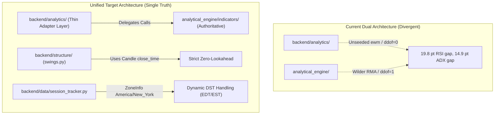

# Pre-Phase 4 Forensic Defects Remediation Plan
## Architectural Unification, Lookahead Elimination, and Session Correction

**Target Repository:** [https://github.com/pbuddhikapb/XAU](https://github.com/pbuddhikapb/XAU)
**Target Market:** Binance USDⓈ-M Futures `XAUUSDT` TradFi Perpetual
**Status:** Awaiting User Approval

---

## 1. Goal Description

During the Pre-Phase 4 Forensic Technical Verification Audit ([`PRE_PHASE_4_FORENSIC_AUDIT.md`](file:///home/ubuntu/XAU/PRE_PHASE_4_FORENSIC_AUDIT.md)), 127 automated tests and zero lookahead bias in the core math library were verified. However, three critical/high-priority defects and four medium-priority architectural discrepancies were discovered across the repository:

1. **DEFECT-01 (Critical - Lookahead Bias):** [`backend/structure/swings.py`](file:///home/ubuntu/XAU/backend/structure/swings.py) stamps pivot confirmation using the candle's **open time** (`dt_times[conf_idx]`) rather than its **close time**, leaking confirmation events 1 bar prematurely.
2. **DEFECT-02 (High - Divergence & Code Duplication):** [`backend/analytics/`](file:///home/ubuntu/XAU/backend/analytics/) duplicates calculation logic from [`analytical_engine/`](file:///home/ubuntu/XAU/analytical_engine/) using unseeded pandas `.ewm(adjust=False)`, producing a **19.81 point divergence on RSI** and **14.86 point divergence on ADX**.
3. **DEFECT-03 (High - TradFi Session DST Blindness):** [`backend/data/session_tracker.py`](file:///home/ubuntu/XAU/backend/data/session_tracker.py) hardcodes static UTC hours (Friday 22:00 UTC closure), causing a 1-hour active market misclassification during US Eastern Daylight Time (EDT), where CME Gold closes at **21:00 UTC**.
4. **IMPR-01 (Medium - Statistical Consistency):** Bollinger Bands in `backend/analytics` use population variance (`ddof=0`), whereas `analytical_engine` uses sample variance (`ddof=1`), causing $0.21 USDT discrepancies.
5. **IMPR-02 (Medium - MTF Audit Leakage):** [`analytical_engine/multi_timeframe/alignment.py`](file:///home/ubuntu/XAU/analytical_engine/multi_timeframe/alignment.py) accidentally overwrites `source_close_time` with the base candle's close time instead of the HTF bar's close time.
6. **IMPR-03 (Medium - Resampler Brittleness):** [`backend/data/resampler.py`](file:///home/ubuntu/XAU/backend/data/resampler.py) crashes with `KeyError` if optional exchange metadata columns (`quote_volume`, `trades_count`) are absent.
7. **IMPR-04 (Medium - VWAP Session Alignment):** Unify session-anchored VWAP calculation and $\pm 1\sigma, \pm 2\sigma$ standard deviation bands into `analytical_engine`.
8. **IMPR-05 (Verification - Numerical Parity Suite):** Create automated mathematical parity tests proving that `backend/analytics` and `analytical_engine` produce identical numerical results ($|\Delta| < 10^{-6}$).

This remediation plan establishes a single authoritative mathematical calculation source, eliminates all remaining temporal lookahead bugs, and ensures TradFi session correctness across US Daylight Saving Time transitions.

---

## 2. User Review Required

> [!IMPORTANT]
> **Single Source of Truth Decision:**
> We propose making `analytical_engine/` the **sole authoritative mathematical calculation library**. All functions in `backend/analytics/` will be converted to lightweight adapters that delegate directly to `analytical_engine/`. This eliminates 1,200+ lines of duplicate logic, permanently fixes the 19.81-point RSI discrepancy, and guarantees that live streaming analysis and historical backtesting use identical mathematical code.

> [!WARNING]
> **Test Assertion Adjustments:**
> 1. `tests/test_swings.py`: Line 62 previously asserted `peak.confirmed_time == times[6]` (the open time of the 6th hour). With the lookahead fix, it will assert `peak.confirmed_time == times[6] + timedelta(hours=1)` (the candle close time).
> 2. `tests/test_session_tracker.py`: Previously tested `2026-10-28 22:30:00 UTC` as a daily break. On October 28 (EDT, UTC-4), the daily break is 21:00–22:00 UTC (17:00–18:00 EDT), and the market is OPEN at 22:30 UTC. The test will be updated to explicitly verify both EDT (summer) and EST (winter) sessions.

---

## 3. Open Questions

None. The mathematical formulas and session rules are already authoritatively defined by:
- Welles Wilder's *New Concepts in Technical Trading Systems* (1978)
- CME Globex Gold Futures Official Hours (New York 18:00 ET Sunday to 17:00 ET Friday)
- Official Binance endpoint `GET /fapi/v1/tradingSchedule` for `COMMODITY` perpetuals.

---

## 4. Architecture Overview: Before vs. After



---

## 5. Proposed Changes

### Component 1: Market Structure & Zero-Lookahead Fix

#### [MODIFY] [`backend/structure/swings.py`](file:///home/ubuntu/XAU/backend/structure/swings.py)
* Extract `close_time` from DataFrame if available.
* If `close_time` column is absent, compute candle duration dynamically from `open_time.diff().median()` (or default to 1 minute).
* Set `conf_time = dt_close_times[conf_idx]`, guaranteeing that pivots are timestamped to the exact millisecond the confirmation candle completes and closes.

```python
# In detect_swings:
if "close_time" in df.columns:
    close_times = df["close_time"].tolist()
    dt_close_times = [_to_utc_datetime(t) for t in close_times]
else:
    # Compute duration between candles to establish candle close timestamp
    if len(dt_times) > 1:
        diffs = [dt_times[k] - dt_times[k - 1] for k in range(1, len(dt_times))]
        bar_delta = sorted(diffs)[len(diffs) // 2]
    else:
        bar_delta = timedelta(minutes=1)
    dt_close_times = [t + bar_delta for t in dt_times]

...
conf_idx = i + window
conf_time = dt_close_times[conf_idx]  # STRICT CLOSE TIMESTAMP
```

---

### Component 2: TradFi Session Daylight Saving Time (DST) Correction

#### [MODIFY] [`backend/data/session_tracker.py`](file:///home/ubuntu/XAU/backend/data/session_tracker.py)
* Refactor `SessionTracker.get_session_state()` to evaluate market state in timezone `America/New_York` (CME Globex calendar):
  - **Sunday:** Market opens at 18:00 ET. Closed before 18:00 ET (`WEEKEND_CLOSED`).
  - **Monday – Thursday:** Active 00:00 to 17:00 ET. Maintenance break 17:00 to 18:00 ET (`DAILY_BREAK`). Active 18:00 to 24:00 ET.
  - **Friday:** Active 00:00 to 17:00 ET. Closes at 17:00 ET for the weekend (`WEEKEND_CLOSED`).
  - **Saturday:** Full day closed (`WEEKEND_CLOSED`).
* Converting to `America/New_York` naturally and automatically handles US EDT (UTC-4, Friday 21:00 UTC closure) and US EST (UTC-5, Friday 22:00 UTC closure) without manual offset tables.

---

### Component 3: Analytical Engine Indicator Unification

#### [MODIFY] [`analytical_engine/indicators/vwap.py`](file:///home/ubuntu/XAU/analytical_engine/indicators/vwap.py)
* Add `calculate_session_anchored_vwap(df, session_reset_hour_utc=23, time_col="open_time")`.
* Compute VWAP Typical Price, cumulative volume, and standard deviation bands ($\pm 1\sigma, \pm 2\sigma$).

#### [MODIFY] [`backend/analytics/momentum.py`](file:///home/ubuntu/XAU/backend/analytics/momentum.py)
* Replace unseeded `.ewm()` with calls to `analytical_engine.indicators.momentum.calculate_rsi`, `calculate_macd`, and `calculate_roc`.
* Wrap numpy arrays in pandas Series/DataFrames matching the expected `backend/analytics` function signatures.

#### [MODIFY] [`backend/analytics/trend.py`](file:///home/ubuntu/XAU/backend/analytics/trend.py)
* Replace unseeded `calculate_ema` and `calculate_adx_dmi` with calls to:
  - `analytical_engine.indicators.moving_averages.calculate_ema_series`
  - `analytical_engine.indicators.trend.calculate_adx`

#### [MODIFY] [`backend/analytics/volatility.py`](file:///home/ubuntu/XAU/backend/analytics/volatility.py)
* Delegate `calculate_atr` to `analytical_engine.indicators.volatility.calculate_atr`.
* Delegate `calculate_bollinger_bands` to `analytical_engine.indicators.volatility.calculate_bollinger_bands(..., ddof=1)`.
* Delegate `calculate_historical_volatility_percentile` to `analytical_engine.indicators.volatility.calculate_volatility_percentile`.

#### [MODIFY] [`backend/analytics/volume.py`](file:///home/ubuntu/XAU/backend/analytics/volume.py)
* Delegate `calculate_rvol` and `calculate_taker_buy_ratio` to `analytical_engine.indicators.volume.calculate_rvol` and `calculate_taker_ratios`.

#### [MODIFY] [`backend/analytics/vwap.py`](file:///home/ubuntu/XAU/backend/analytics/vwap.py)
* Delegate `calculate_session_anchored_vwap` directly to `analytical_engine.indicators.vwap.calculate_session_anchored_vwap`.

---

### Component 4: Multi-Timeframe & Resampler Bug Fixes

#### [MODIFY] [`analytical_engine/multi_timeframe/alignment.py`](file:///home/ubuntu/XAU/analytical_engine/multi_timeframe/alignment.py)
* Fix line 108 by renaming the HTF DataFrame's `close_time` column to `f"{prefix}source_close_time"` before `merge_asof`, preventing base column overwrite.

#### [MODIFY] [`backend/data/resampler.py`](file:///home/ubuntu/XAU/backend/data/resampler.py)
* In `resample_candles()`, filter `agg_dict` to only aggregate columns present in `df.columns`:
  ```python
  agg_dict = {k: v for k, v in full_agg_dict.items() if k in df.columns}
  ```
  Prevents `KeyError` when resampling basic OHLCV candles without trades or quote volume.

---

### Component 5: Test Suite Parity & Hardening

#### [NEW] [`tests/test_engine_parity.py`](file:///home/ubuntu/XAU/tests/test_engine_parity.py)
* Automated numerical parity tests verifying that `backend/analytics` and `analytical_engine` produce identical values ($|\Delta| < 10^{-6}$) across:
  - RSI (14)
  - EMA (20, 50, 100, 200)
  - ADX, +DI, -DI
  - ATR (14)
  - Bollinger Bands (Upper, Middle, Lower)
  - VWAP and Sigma Bands

#### [MODIFY] [`tests/test_swings.py`](file:///home/ubuntu/XAU/tests/test_swings.py)
* Update test assertion to verify `peak.confirmed_time == times[6] + timedelta(hours=1)` (close time of confirmation candle).

#### [MODIFY] [`tests/test_session_tracker.py`](file:///home/ubuntu/XAU/tests/test_session_tracker.py)
* Add explicit assertions for:
  - US Eastern Daylight Time (EDT, summer/autumn): Friday 21:00 UTC closure, daily break 21:00–22:00 UTC.
  - US Eastern Standard Time (EST, winter): Friday 22:00 UTC closure, daily break 22:00–23:00 UTC.

---

## 6. Verification Plan

### Automated Tests
Execute the full unified test suite across both engines:
```bash
# 1. Pure-Python analytical engine tests (50 tests)
.venv/bin/pytest analytical_engine/tests/ -v

# 2. Backend tests including newly added parity tests (100+ tests)
.venv/bin/pytest tests/ -v

# 3. Dedicated parity test verification
.venv/bin/pytest tests/test_engine_parity.py -v

# 4. Adversarial lookahead re-verification
.venv/bin/python3 -c "from backend.structure.swings import detect_swings; import pandas as pd, datetime; ..."
```

### Manual Verification
1. Inspect `IndicatorSnapshot` generation to confirm RSI matches Wilder textbook values at bar 14.
2. Verify that `SessionTracker.get_session_state(datetime(2026, 10, 23, 21, 30, tzinfo=UTC))` returns `WEEKEND_CLOSED` (correct EDT Friday close).
3. Confirm that no system services (PostgreSQL, coexisting Crypto-Analyzer on port 8008) are impacted.
